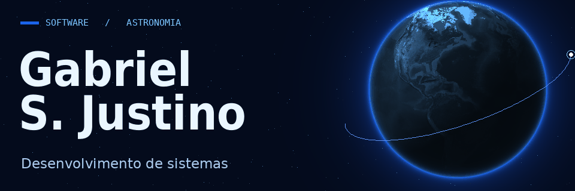
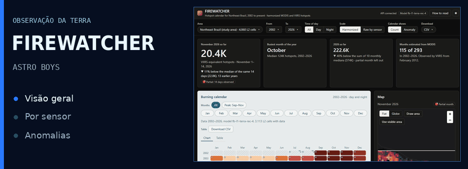
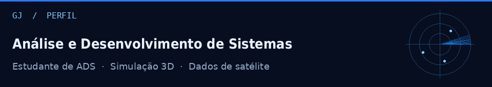
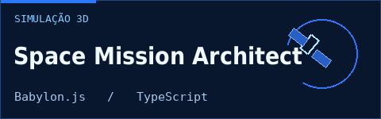
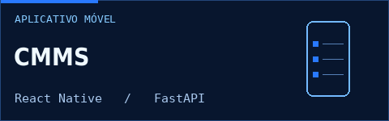
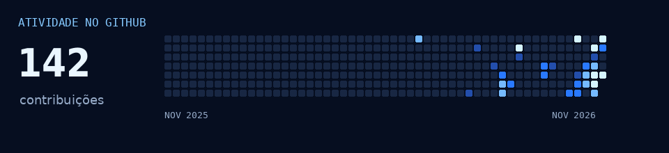

<picture>
  <source media="(prefers-reduced-motion: reduce)" srcset="assets/observatorio.png">
  
</picture>

  <a href="https://www.gabrieljustino.com.br/"><b>Portfólio</b></a> &nbsp; · &nbsp;
  <a href="https://www.linkedin.com/in/gabriel-justino-dev">LinkedIn</a> &nbsp; · &nbsp;
  <a href="mailto:gabrieljustino.dev@outlook.com.br">E-mail</a>

## FIREWATCHER

**Engenharia de dados · Equipe Astro Boys · NASA Space Apps Challenge 2026**

Se um sensor registra mais focos de calor que outro, como saber quanto dessa diferença vem da resolução de cada instrumento? Essa foi uma das questões que enfrentamos ao reunir observações dos sensores **MODIS e VIIRS**. Na equipe Astro Boys, minha contribuição foi pesquisar e documentar as fontes de dados do **NASA FIRMS**.

<a href="https://astro-dashboard-301238386836.us-central1.run.app/">
  <picture>
    <source media="(prefers-reduced-motion: reduce)" srcset="assets/firewatcher.png">
    
  </picture>
</a>

No painel, escolha uma região e compare um mês com a mediana histórica daquela área. O calendário ajuda a perceber padrões sazonais que um mapa isolado esconderia.

**[Abrir o painel](https://astro-dashboard-301238386836.us-central1.run.app/)** · [Explorar o código](https://github.com/1kaliel/astro-boys) · [Ler a metodologia](https://github.com/1kaliel/astro-boys/blob/main/docs/methodology.md)

## Sobre mim

<picture>
  <source media="(prefers-reduced-motion: reduce)" srcset="assets/radar.png">
  
</picture>

Gosto de explorar o espaço pelos dois lados da tela. No FIREWATCHER, começo com observações que já chegaram à Terra. No **Space Mission Architect**, começo no hangar e experimento o que acontece com a trajetória quando acrescento um instrumento à sonda.

## Outros projetos

- **Space Mission Architect** permite montar uma sonda e planejar missões à órbita terrestre, à Lua ou a Júpiter. A massa dos instrumentos entra no cálculo de combustível de cada manobra. [Ver os modelos físicos](https://github.com/Gabriel-S-Justino/SpaceMissionArchitect/blob/Main/docs/physics-model.md)
- **CMMS** reúne o histórico dos equipamentos, as ordens de serviço e o planejamento de manutenção preventiva em um aplicativo móvel. [Ver o projeto](https://github.com/Gabriel-S-Justino/CMMS)

## Tecnologias

Uso **React e TypeScript** nas interfaces e **Babylon.js** nas cenas 3D. No backend do simulador, uso **Python, FastAPI e PostgreSQL**, com **Docker Compose** para o ambiente local. Os testes cobrem as regras da simulação, a API e os fluxos no navegador com **Vitest, pytest e Playwright**.

## Atividade no GitHub

<picture>
  <source media="(prefers-reduced-motion: reduce)" srcset="assets/atividade.png">
  
</picture>

Registro de 19 de novembro de 2026. [Consultar o calendário atual no GitHub](https://github.com/Gabriel-S-Justino?tab=overview#js-contribution-activity)

Terra da capa: NASA Earth Observatory, Blue Marble · Capturas do FIREWATCHER: equipe Astro Boys · Ícones: Skill Icons.
