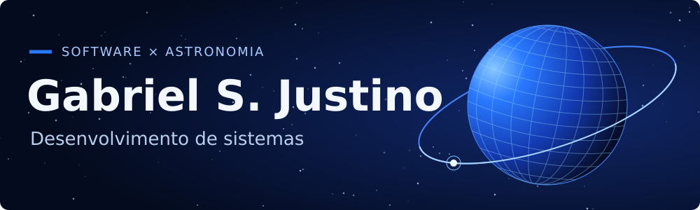

[LinkedIn](https://www.linkedin.com/in/gabriel-justino-dev) · [E-mail](mailto:gabrieljustino.dev@outlook.com.br)

## Sobre mim

Sou Gabriel, estudante de **Análise e Desenvolvimento de Sistemas**. Gosto de astronomia e de programar simulações porque posso mudar uma condição e observar o que acontece. Uma pergunta que virou código no meu GitHub foi esta: **se eu adicionar um instrumento à sonda, ainda sobra combustível para chegar ao destino?**

## Em destaque · Space Mission Architect

No meu simulador educacional 3D, você monta uma sonda, escolhe o lançador e planeja uma missão. Há três destinos para explorar: observar o clima a partir da órbita terrestre, mapear a superfície lunar ou colocar uma sonda em órbita de Júpiter.

A massa de cada componente entra no cálculo das manobras. Outro detalhe está no lançamento: a simulação avança em intervalos fixos, mesmo quando a taxa de quadros varia. Assim, a velocidade com que o navegador desenha a cena não altera a trajetória calculada.

[Explorar o simulador no GitHub](https://github.com/Gabriel-S-Justino/SpaceMissionArchitect) · [Ver os modelos físicos e suas simplificações](https://github.com/Gabriel-S-Justino/SpaceMissionArchitect/blob/Main/docs/physics-model.md)

## Ferramentas que uso

| Área | Aplicação nos meus projetos |
| --- | --- |
| Gráficos e interfaces | **Babylon.js** renderiza as cenas 3D. **React e TypeScript** dão forma às telas de planejamento da missão. |
| APIs e dados | Uso **Python, FastAPI e PostgreSQL** no backend do simulador e no sistema de manutenção. |
| Aplicativos móveis | Uso **React Native e Expo** no [CMMS](https://github.com/Gabriel-S-Justino/CMMS), onde cada equipe acompanha seus equipamentos e ordens de serviço. |
| Testes | O simulador reúne testes com **Vitest** no frontend, **pytest** na API e **Playwright** nos fluxos de ponta a ponta. |

Se você também desenvolve simulações, qual fenômeno astronômico levaria para o navegador? [Vamos conversar no LinkedIn](https://www.linkedin.com/in/gabriel-justino-dev).
