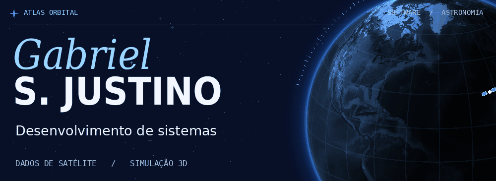
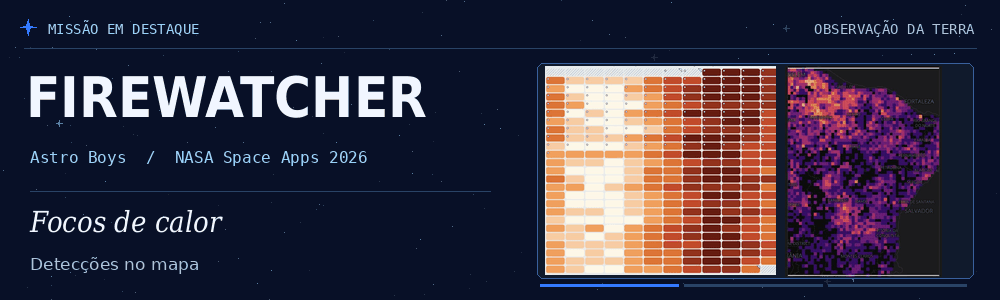
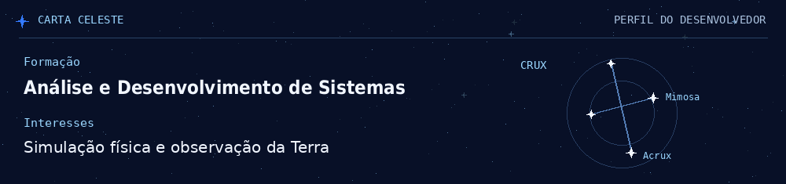
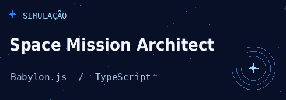
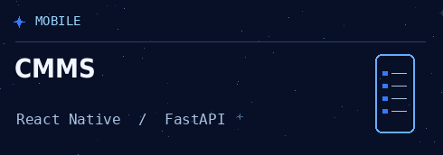
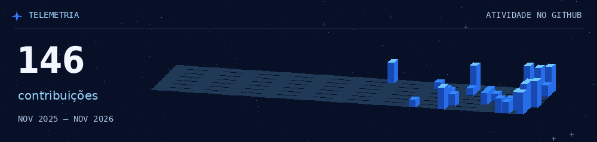

<picture>
  <source media="(max-width: 600px) and (prefers-reduced-motion: reduce)" srcset="assets/atlas/capa-mobile.png">
  <source media="(max-width: 600px)" srcset="assets/atlas/capa-mobile.gif">
  <source media="(prefers-reduced-motion: reduce)" srcset="assets/atlas/capa.png">
  
</picture>

  
  
  

<picture>
  <source media="(max-width: 600px) and (prefers-reduced-motion: reduce)" srcset="assets/atlas/firewatcher-mobile.png">
  <source media="(max-width: 600px)" srcset="assets/atlas/firewatcher-mobile.gif">
  <source media="(prefers-reduced-motion: reduce)" srcset="assets/atlas/firewatcher.png">
  
</picture>

**Como comparar duas décadas de focos de calor se os sensores mudaram nesse intervalo?** No NASA Space Apps Challenge 2026, participei da equipe **Astro Boys** como engenheiro de dados. Pesquisei e documentei as fontes do **NASA FIRMS** usadas para comparar as observações dos sensores MODIS e VIIRS.

No FIREWATCHER, escolha uma região no mapa e abra o calendário. Você pode comparar a atividade de um mês com a mediana histórica daquela área e voltar às detecções de cada sensor para investigar a diferença.

**[Abrir o FIREWATCHER ↗](https://astro-dashboard-301238386836.us-central1.run.app/)**　·　[Repositório](https://github.com/1kaliel/astro-boys)　·　[Metodologia](https://github.com/1kaliel/astro-boys/blob/main/docs/methodology.md)

<picture>
  <source media="(prefers-reduced-motion: reduce)" srcset="assets/atlas/crux.png">
  
</picture>

Estudo **Análise e Desenvolvimento de Sistemas**. Gosto tanto de investigar o que um satélite observou quanto de escrever o código que simula seu voo. No **Space Mission Architect**, por exemplo, acrescentar um instrumento à sonda muda a massa que o motor precisa acelerar. Dá para experimentar essa escolha antes de partir para Júpiter.

### Projetos

### Instrumentos de desenvolvimento

| Onde uso | Ferramentas |
| --- | --- |
| **Simulação no navegador** · cenas 3D e telas de planejamento da missão | Babylon.js, React e TypeScript |
| **APIs e persistência** · dados do simulador e registros do CMMS | Python, FastAPI e PostgreSQL |
| **Mobile e testes** · telas do CMMS e verificação do simulador | React Native e Expo · Vitest, pytest e Playwright |

<picture>
  <source media="(prefers-reduced-motion: reduce)" srcset="assets/atlas/telemetria.png">
  
</picture>

Quanto mais alta a coluna, mais contribuições naquele dia. Registro de **19 de novembro de 2026**. [Ver atividade atual no GitHub ↗](https://github.com/Gabriel-S-Justino?tab=overview#js-contribution-activity)

Para conversar sobre um projeto ou uma oportunidade, me encontre no [LinkedIn](https://www.linkedin.com/in/gabriel-justino-dev) ou escreva para [gabrieljustino.dev@outlook.com.br](mailto:gabrieljustino.dev@outlook.com.br).

Terra da capa · NASA Earth Observatory, Blue Marble. Capturas do FIREWATCHER · equipe Astro Boys. Ícones das tecnologias · Skill Icons.
