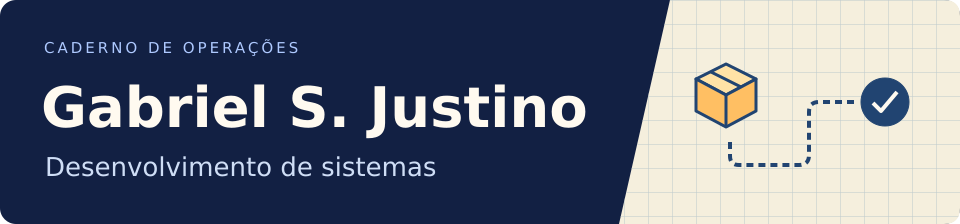

[LinkedIn](https://www.linkedin.com/in/gabriel-justino-dev) · [E-mail](mailto:gabrieljustino.dev@outlook.com.br)

## De Compras e Operações para o código

Quando um pedido atrasa, a primeira pergunta costuma ser “qual era a previsão de entrega?”. A seguinte é “onde ficou registrada?”. Venho de Compras e Operações, e é esse tipo de pergunta que me leva a desenvolver software.

Hoje estudo **Análise e Desenvolvimento de Sistemas**. Nos meus projetos, gosto de pegar uma rotina que já existe, entender quem faz cada etapa e decidir o que vale automatizar. Uma planilha de preços foi um bom ponto de partida.

## Por dentro do PriceFlow

A planilha original já calculava preços. Ao levar esse cálculo para a web, precisei representar outra parte do trabalho também: **quem pode alterar um preço e em que momento?**

No [PriceFlow](https://github.com/Gabriel-S-Justino/PriceFlow), o operador prepara um lote em rascunho e o gerente revisa os valores enviados para análise. O cálculo usa os parâmetros comerciais e fiscais cadastrados. A equipe pode consultar o histórico de alterações e exportar o lote para Excel.

## Outros projetos

### [Controle de Pedidos](https://github.com/Gabriel-S-Justino/Controle-de-Pedidos) · Compras e logística
Reúne fornecedor, transportadora, previsão de chegada e documentos no registro de cada pedido. Quem acompanha a compra pode consultar as observações e registrar a entrega no mesmo lugar.

### [CMMS](https://github.com/Gabriel-S-Justino/CMMS) · Manutenção de equipamentos
Organiza o trabalho em torno de cada ativo. A equipe pode consultar seu histórico, abrir ordens de serviço e agendar manutenções preventivas recorrentes. Os registros ficam separados por empresa, com permissões por perfil.

## Onde uso cada tecnologia

| Nos projetos | Ferramentas |
| --- | --- |
| Telas do aplicativo de manutenção | React Native, Expo e TypeScript |
| API de ativos e ordens de serviço | Python, FastAPI e PostgreSQL |
| Aplicação web de pedidos de compra | Python, Flask e SQLite |
| Ambiente de desenvolvimento do CMMS | Docker Compose |

Se você trabalha com desenvolvimento de sistemas para operações, vou gostar de saber como sua equipe resolve esses problemas. [Vamos conversar no LinkedIn](https://www.linkedin.com/in/gabriel-justino-dev).
